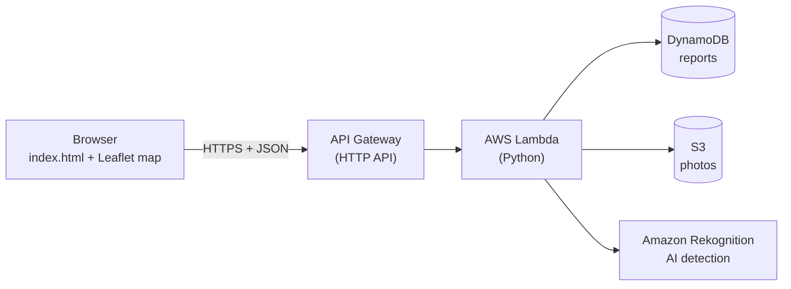

# Paryavaran-Lens
# Environmental_Hacks
# 🌿 Paryavaran Lens

**Snap it. Pin it. Get it fixed.**
Report an environmental problem in Delhi with a single photo. The app identifies the problem, pins where the photo was taken on a live map, and sends the report to the right authority.

> *Paryavaran* (पर्यावरण) means "environment" in Hindi. Built for the AWS **We Make Devs** hackathon.

<!-- 📸 Add a screenshot here:  -->

**Team:** Gourang Chanana, Dharneet Kaur, Dhairya Nagpal, Divyam Suyal · Delhi Technological University (DTU)

---

## What it does

1. 📷 **Capture a photo** of the problem.
2. 🤖 **Identify the problem**, either automatically with AI (Amazon Rekognition) or by choosing it from a dropdown: garbage pile, burning waste, river foam, blocked drain.
3. 📍 **Locate it on the map.** The app reads the GPS location stored in the photo (or uses the device's location) and drops a pin where it was taken.
4. 🏛️ **Send it to the right authority** and track its status: *Reported → Forwarded → In progress → Fixed*.

| Problem | Authority |
|---|---|
| Garbage pile | MCD |
| Burning waste | DPCC |
| River foam / water pollution | DPCC / DJB |
| Blocked drain | DJB |

## Architecture



**Stack:** HTML/CSS/JavaScript · Leaflet (Esri map tiles) · API Gateway · Lambda (Python) · DynamoDB · S3 · Rekognition

## Repository

```
├── index.html            # Frontend: report form + live map
├── lambda_function.py    # Backend: API routes + AI detection
└── README.md
```

## API

| Method | Path | Description |
|---|---|---|
| `GET` | `/reports` | List all reports |
| `POST` | `/report` | Create a report |
| `POST` | `/report/{id}/status` | Update a report's status |

```json
// POST /report
{
  "image_base64": "<JPEG as base64, max 5 MB>",
  "lat": 28.6519,
  "lng": 77.1909,
  "note": "optional",
  "category_override": "garbage_pile"   // optional: omit to let AI decide
}
```

## Setup

1. **DynamoDB:** create table `paryavaran-reports` with partition key `id` (String).
2. **S3:** create a private bucket for photos (keep *Block all public access* ON).
3. **Lambda:** create a Python function, paste in `lambda_function.py`, set your values, and deploy:
   ```python
   REGION = "ap-southeast-2"
   TABLE_NAME = "paryavaran-reports"
   BUCKET = "your-bucket-name"
   ```
   The function's role needs access to DynamoDB, S3 and `rekognition:DetectLabels`.
4. **API Gateway:** create an HTTP API with the three routes above, attach the Lambda (payload format 2.0), and enable CORS (origin `*`, header `content-type`, methods `GET, POST, OPTIONS`).
5. **Frontend:** put your API's Invoke URL in `index.html`:
   ```js
   const API = "https://<api-id>.execute-api.<region>.amazonaws.com";  // no trailing slash
   ```

## Run locally

Serve the page instead of double-clicking it (browsers send origin `null` for local files, which CORS rejects):

```bash
python3 -m http.server 8000
# open http://localhost:8000/index.html
```

## Limitations & next steps

- Authority status buttons have no login yet. Next step: Amazon Cognito.
- AI detection is keyword-based on Rekognition labels, so it's best for clear garbage and fire/smoke photos. The dropdown is always available as a fallback.
- Host the frontend on S3 + CloudFront for a public HTTPS link.
